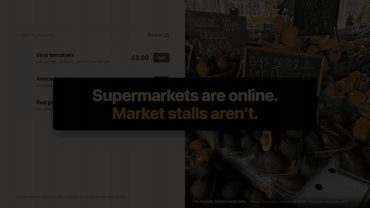
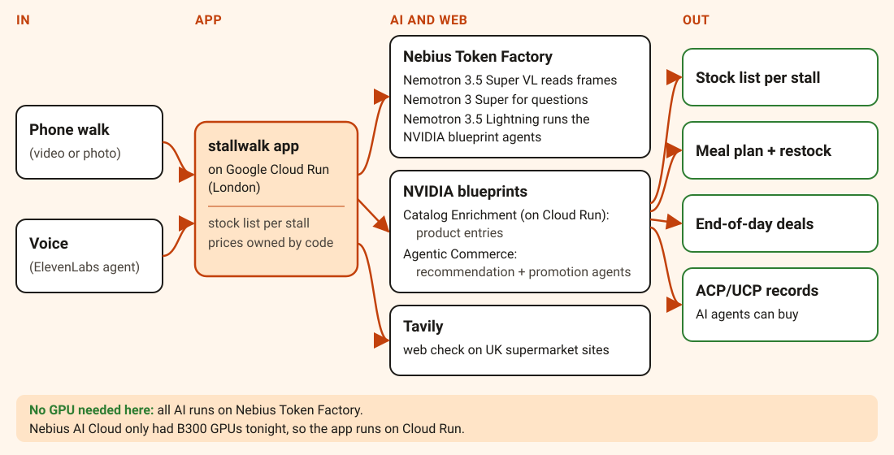
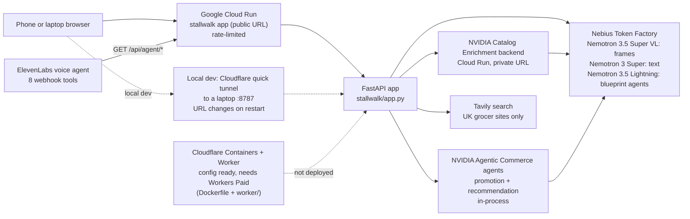
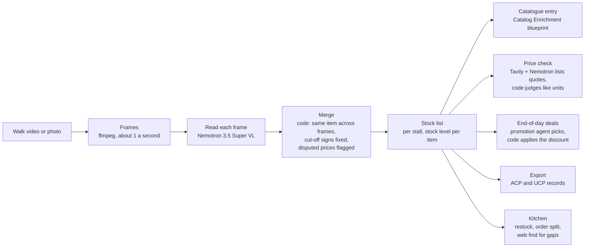

<div align="center">

# 🧺 stallwalk

**Supermarkets are online. Market stalls aren't.<br>stallwalk turns a phone walk into live market stock: what's on each stall, at what price, and what came in this morning. Like a supermarket website, for the market.**

_Innovators Guild hackathon (Fresha × Nebius) · Retail Commerce track · 24 Nov 2026_


[**Demo video (60 s)**](https://youtu.be/TyyTZYJPsbU) · [**How it works**](#how) · [**Results**](#results) · [**Run it locally**](#run) · [**Voice agent**](voice/README.md)

</div>

<p align="center">
  <a href="https://youtu.be/TyyTZYJPsbU"></a>
  <br>
  <sub>▶ Silent preview of the 60-second demo. <a href="https://youtu.be/TyyTZYJPsbU"><b>Watch the full video with sound</b></a><br>The demo market's stalls and prices are made up.</sub>
</p>

> **In 30 seconds.** Someone walks past the stalls, or round a kitchen stock room, filming on a phone. stallwalk pulls frames from the video, has a vision model on Nebius Token Factory read each one, and then code merges the readings into one stock list per stall, with a stock level per item. Code owns every price: a price it can't read stays blank, and a price that differs across frames gets flagged, never averaged. From that list it works out what's run out, prices an order across the stalls, checks prices against UK supermarket websites, suggests end-of-day deals for the stallholder, and turns the list into product records an AI shopping agent can buy from. A voice agent sits on top and answers only from the app.

**What you can do with it** (the moules frites demo is one example):

- **Check before you go:** "Is there wild garlic at the market today?"
- **What's in season and just in:** the freshest arrivals from this morning's walk.
- **Plan a dish or restock a kitchen:** it checks your stockroom, then tells you which stall to go to for each item, and where to pick up the rest (Tavily web search).
- **Sell more:** stallholders list a stall with a 10-second pan, and clear stock with end-of-day deals.
- **Let AI agents buy:** stalls become listings an AI shopping assistant can buy from.
- **Not just markets:** a salon's retail shelf or colour cupboard works the same way: one walk, a stock list, and what's low to reorder.

| **46 of 49** | **29 of 30** | **11 of 13** | **45 of 48** |
|:---:|:---:|:---:|:---:|
| office kitchen items listed right<br><sub>3 photos, hand-checked ([RESULTS.md](experiments/RESULTS.md))</sub> | market items named right<br><sub>7 English Commons price-card photos ([RESULTS.md](experiments/RESULTS.md))</sub> | prices it read were right<br><sub>same 7 photos; it left the rest blank ([RESULTS.md](experiments/RESULTS.md))</sub> | deal decisions matched the blueprint's own decision table<br><sub>made-up end-of-day stock ([DEMO.md ledger](experiments/DEMO.md#claim-ledger))</sub> |

<sub>Hand-checked by Kash on 24 Nov 2026, about halfway through the set; only ticked photos count. Every number said in the demo is traced to a file and commit in the <a href="experiments/DEMO.md#claim-ledger">claim ledger</a>.</sub>

> 💡 Every section opens with a one-line answer. Click any ▸ line to unfold the detail.

### Contents

1. [🧭 How it works](#how)
2. [🔌 Models and platform](#models)
3. [📊 Results](#results)
4. [🚀 Run it locally](#run)
5. [🚧 Known limits](#limits)
6. [🙏 Credits and licences](#credits)

---

## <a name="how"></a>1. 🧭 How it works

<p align="center"></p>

**A FastAPI app on Google Cloud Run does all the work. The models read and suggest; code merges, prices, converts units and decides what's buyable.**

<details>
<summary><b>How a request reaches the app, and what it calls</b></summary>

<br>

During the event it ran on Google Cloud Run behind a Cloudflare Worker on my own domain, with the voice agent's tools pointing at Cloud Run and the Catalog Enrichment backend on Cloud Run too. That hosting has since been taken down; the demo video shows it working. For local development the app runs on a laptop behind a Cloudflare quick tunnel. The Cloudflare Containers config (Dockerfile and worker/) is ready but needs Workers Paid, so it isn't deployed.



- The voice agent's tools point at the Cloud Run URL. `voice/setup_agent.py --public-url <url>` re-points all eight tools in place, for example at a quick tunnel during local development.
- During the event the Catalog Enrichment backend ran on Cloud Run too, so catalogue entries worked on the hosted site.
- The two Agentic Commerce agents run inside the app's process, with their prompts loaded from the blueprint's own config files.

</details>

<details>
<summary><b>From a walk video to a stock list, and what hangs off it</b></summary>

<br>



- **Read.** The frame prompt asks for every sign and every product whose label can be read, and says never to guess a price. A photo can also be read whole plus four overlapping tiles.
- **Merge** (`stallwalk/walk.py`). Code joins the same item seen in several frames, maps cut-off signs ("lly's Fresh Fish") to the fullest one seen, and flags anything unclear: prices that differ across frames, items only seen blurry.
- **Price check** (`stallwalk/pricecheck.py`). One Tavily search per item on UK supermarket sites. Nemotron only lists the prices the snippets state. Code keeps like-unit quotes, drops strays, takes the range, and needs at least two quotes before it flags a price as high or low. It adds a flag with its sources and never changes a price.
- **Kitchen** (`stallwalk/kitchen.py`). The model only turns order text into lines. Code reads the quantities from the text, matches each line against the stalls, converts units (dozen to each, grams to kilos, 200g packs), picks the cheapest stall and multiplies. Anything no stall has comes back as "not on any stock list", and **web find** (`stallwalk/webfind.py`) then gives an online UK supermarket price for it, labelled "web estimate, online price".
- **Deals** (`stallwalk/blueprint_promo.py`). The blueprint's promotion agent picks an action for each item from the allowed list. Code applies the discount and blocks anything under the margin floor.
- **What goes with it** (`stallwalk/blueprint_reco.py`). The blueprint's recommendation agent picks from the stock list. Code removes what you already have, and code fills in every price and stall.
- **Export** (`stallwalk/export.py`). The stock list becomes ACP and UCP product records. Items with a missing or disputed price stay in but are marked not buyable.

</details>

<details>
<summary><b>The voice agent</b></summary>

<br>

An ElevenLabs Conversational AI agent with eight read-only webhook tools: `plan_meal`, `find_item`, `list_stalls`, `whats_run_out`, `split_order`, `check_stockroom`, `web_find` and `what_goes_with`. Its prompt makes it call a tool before any answer about stock, prices, the stockroom or orders. It never says a price that isn't in a tool's answer, and it says "web estimate" when the tool does. For a meal, it says a short line while it works, builds the ingredient list, and makes one `plan_meal` call: the stockroom check, market prices for what's low or out, and online web estimates for the rest. If asked where to buy locally, it points to the supermarkets' own store finders and never names a branch. Setup and tests: [voice/README.md](voice/README.md).

</details>

## <a name="models"></a>2. 🔌 Models and platform

**Every model call goes to Nebius Token Factory. Nebius owns Tavily, so we use Tavily for the web checks.**

<details>
<summary><b>Which model does what</b></summary>

<br>

| | Used for |
|---|---|
| **NVIDIA Nemotron 3.5 Super VL** (`nvidia/Nemotron-3.5-Super-VL`) | Reads every frame. Picked over GLM-5.3-Flash and gemma-3-27b-it by a rule written before the run ([AB.md](experiments/AB.md)) |
| **NVIDIA Nemotron 3 Super** (`nvidia/nemotron-3-super-120b-a12b`) | Text: parses orders, lists the prices in web snippets |
| **NVIDIA Nemotron 3.5 Lightning** (`nvidia/Nemotron-3_5-Lightning`) | The Agentic Commerce blueprint's promotion and recommendation agents |
| **GLM-5.3-Flash** (`zai-org/GLM-5.3-Flash`) | Fallback frame reader |
| **Nebius Token Factory** | Serves all of the above |
| **Tavily** | Price check and web find, limited to UK supermarket sites |
| **NVIDIA Retail Catalog Enrichment blueprint** | Catalogue entry per item (backend on Cloud Run with a private URL, or localhost:8000 locally), and the shape of the ACP and UCP records |
| **NVIDIA Retail Agentic Commerce blueprint** | Promotion agent (layers and margin check copied) and recommendation agent (pipeline imported unchanged) |
| **ElevenLabs Conversational AI** | The voice agent |
| **Google Cloud Run** | Hosts the app (public URL) and the Catalog Enrichment backend (private URL) |
| **Cloudflare** | Worker proxy on my domain during the event (free plan, since removed); quick tunnel for local development; Containers config ready, needs Workers Paid |

Model ids are the defaults in `stallwalk/tf.py`, `stallwalk/blueprint_promo.py` and `stallwalk/blueprint_reco.py`, and each can be changed by an environment variable.

</details>

## <a name="results"></a>3. 📊 Results

**Hand-checked on real photos, plus a synthetic walk with a known answer. Every number below has a source file.**

<details>
<summary><b>The numbers and where they come from</b></summary>

<br>

| What | Result | Source |
|---|---|---|
| Office kitchen, 3 photos | 46 of 49 listed were right; missed about 10 small snack packs; caught the one empty dispenser but listed it twice | [RESULTS.md](experiments/RESULTS.md) |
| Market price cards, 7 English Commons photos | 29 of 30 items right; 11 of 13 prices read right; the rest left blank, not guessed | [RESULTS.md](experiments/RESULTS.md) |
| Synthetic 3-stall walk, 16 frames | Nemotron 3.5 Super VL: 100% found and 100% prices right, 3.8 s for 16 frames (GLM-5.3-Flash 16.2 s; gemma-3-27b-it timed out on 7 of 16) | [AB.md](experiments/AB.md) |
| Seeded misread | Mussels £6/kg changed to £60/kg gets flagged "about 7x the usual UK price (UK supermarkets £4.50-£9.00 per kg)" with Tesco and Morrisons links | [PRICECHECK.md](experiments/PRICECHECK.md) |
| End-of-day deals | 45 of 48 decisions followed the blueprint's own decision table; code applies every discount and blocks anything under the margin floor | [DEMO.md ledger](experiments/DEMO.md#claim-ledger) |
| Meal order on the made-up market | Mussels 2 kg £12.00, potatoes 1 kg £0.90, shallots 200 g £0.48, garlic £0.50, parsley £0.80; market total £14.68 | [DEMO.md ledger](experiments/DEMO.md#claim-ledger) |
| Gaps priced online | White wine £4.29 to £12.50 each (Aldi, Waitrose); butter £1.95 to £4.50 each (Tesco, Trolley). Web estimates, not card prices | [DEMO.md ledger](experiments/DEMO.md#claim-ledger) |

The price-check runs, including a false flag in run 2 and the fix, are in [PRICECHECK.md](experiments/PRICECHECK.md). The kitchen order and restock runs are in [KITCHEN.md](experiments/KITCHEN.md).

</details>

## <a name="run"></a>4. 🚀 Run it locally

**`uv sync`, a Token Factory key in `.env`, then `uvicorn` on port 8787. The tests run offline.**

<details>
<summary><b>Setup, keys and commands</b></summary>

<br>

Needs Python 3.11+, [uv](https://docs.astral.sh/uv/) and ffmpeg.

```sh
uv sync
```

`.env` in the repo root:

```sh
TOKENFACTORY_API_KEY=...      # required: every model call
TAVILY_API_KEY=...            # price check and web find
ELEVENLABS_API_KEY=...        # only for voice/setup_agent.py (needs Agents write access)
```

Run the app and open http://localhost:8787:

```sh
uv run uvicorn stallwalk.app:app --host 0.0.0.0 --port 8787
```

A walk from the command line, on the synthetic fixture with its hand count:

```sh
uv run python fixtures/make_fixture.py
uv run python -m stallwalk walk fixtures/synthetic_walk.mp4 --truth fixtures/synthetic_truth.json
```

Tests, offline with recorded responses, no keys:

```sh
uv run python -m pytest -q
```

Optional parts:

- **Voice agent.** Put the app on a public URL (`cloudflared tunnel --url http://localhost:8787`), then `uv run python voice/setup_agent.py --public-url <url> --test`.
- **Catalogue entry.** Run NVIDIA's Retail Catalog Enrichment backend on localhost:8000, or set `CATALOG_ENRICHMENT_URL`.
- **Deals and "what goes with it".** Both read NVIDIA's Retail Agentic Commerce blueprint from `AGENTIC_COMMERCE_DIR` (the needed files are vendored in `vendor/retail-agentic-commerce/`).

</details>

## <a name="limits"></a>5. 🚧 Known limits

**The market is made up, the real evidence is small and hand-checked, and the hosted demo has been taken down.**

<details>
<summary><b>The full list</b></summary>

<br>

- **Synthetic market.** The meal market, the stockroom and the three market stock lists in `fixtures/` are made up, and are labelled that way in the files. The real evidence is 3 office kitchen photos and 7 English Commons price-card photos, hand-checked about halfway through the set.
- **The office footage isn't in the repo.** Only the text item lists the pipeline produced from it are, in `fixtures/real_kitchen/`.
- **No hosted demo.** The Cloud Run hosting, the domain and the voice agent were taken down after the event. Run it locally (above) or watch the video. While it was up it had no login, so the app rate-limits paid calls: per IP, 60 per 10 minutes, 400 in total, with a 429, a Retry-After header and an answer the voice agent can say. The Cloudflare Containers config is ready but needs Workers Paid, so it isn't deployed.
- **The Shopping Assistant and Multi-Agent Intelligent Warehouse blueprints weren't run:** Shopping Assistant needs safety models that aren't on Token Factory, and Warehouse is a different problem.
- **Recommendation picks are weak on the small market.** The blueprint picks from a handful of items, so code removes what you already have and the rest is often obvious (for moules frites: garlic, potatoes, shallots).
- **Web prices are online prices.** Tavily can't see local shops, stock or opening hours, so every answer says to check the local store. Pack sizes mix (a can against a multipack), and an estimate spread wider than 4x is dropped.
- **A flag needs two web quotes.** That stopped a false flag, and it also means a misread with only one quote isn't flagged (Red Onions at £12/kg in [PRICECHECK.md](experiments/PRICECHECK.md)).
- **Small snack packs get missed** on busy shelves (about 10 on one kitchen photo).

</details>

## <a name="credits"></a>6. 🙏 Credits and licences

The market-stall idea first came up as Market Live at The Build Room Leicester 01.

<details>
<summary><b>Blueprints, photos and code</b></summary>

<br>

- **NVIDIA Retail Catalog Enrichment blueprint** (Apache-2.0). The ACP and UCP record shape in `stallwalk/export.py` follows its builders, and the catalogue entry calls its backend.
- **NVIDIA Retail Agentic Commerce blueprint** (Apache-2.0). `stallwalk/blueprint_promo.py` copies the promotion service's layers and margin check and loads the agent's prompt from the blueprint's config. `stallwalk/blueprint_reco.py` imports the recommendation pipeline unchanged and loads its prompts from the blueprint's config. Credits are in each file's header.
- **Price-card photos** are from Wikimedia Commons under CC0, CC BY and CC BY-SA. Each photo's title, licence and link is in [fixtures/commons/CREDITS.md](fixtures/commons/CREDITS.md).
- **Nebius owns Tavily, so we use Tavily for the web checks.**
- **Code:** AI-generated under my direction.

</details>

---

Built by Kashif Nazir · [kashifnazir.com](https://kashifnazir.com)
